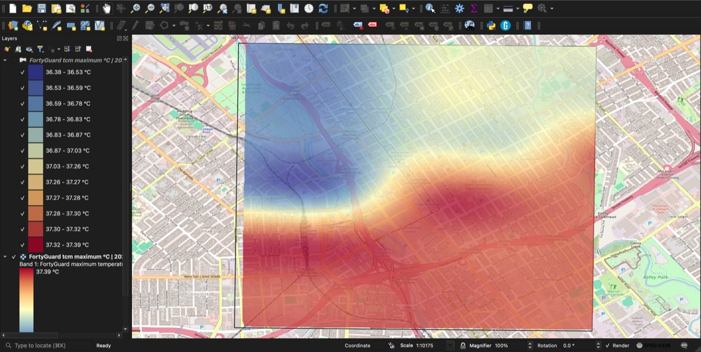
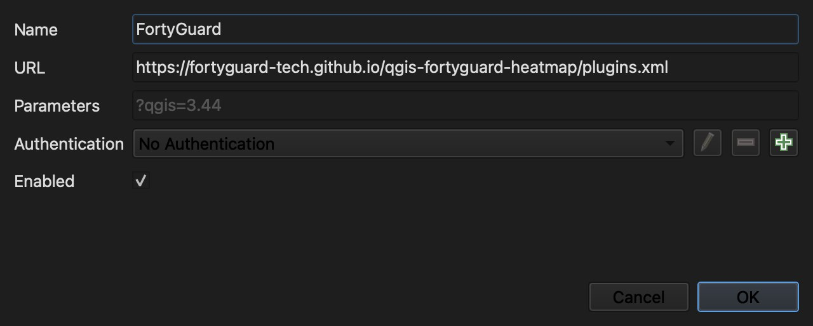
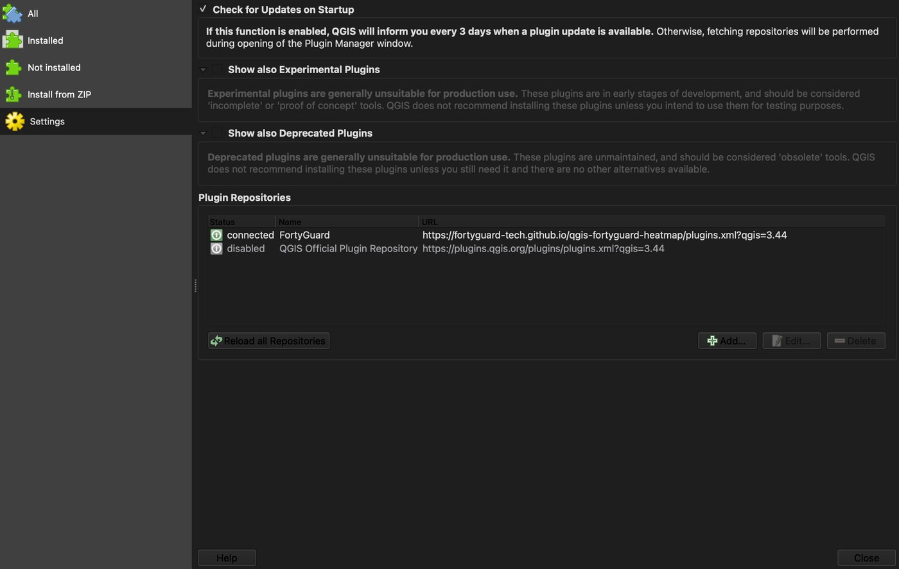
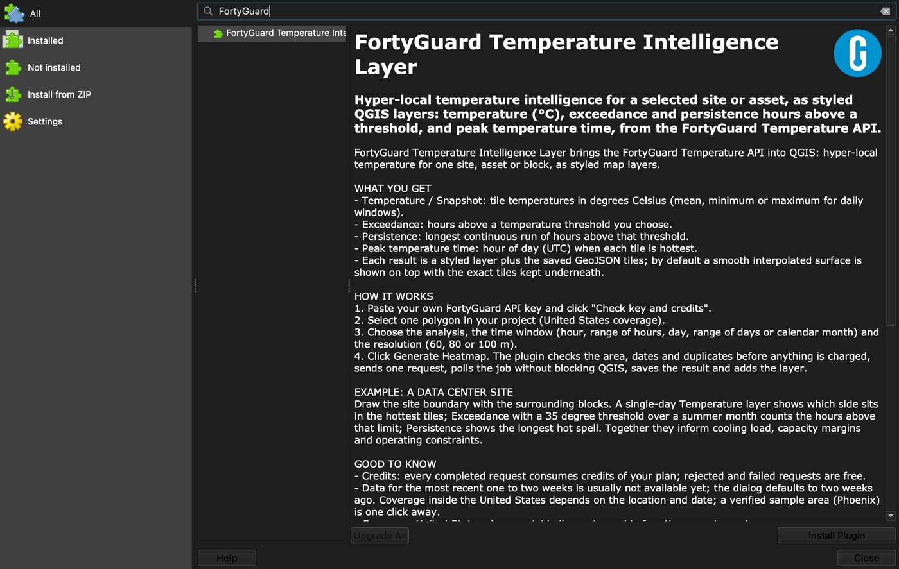
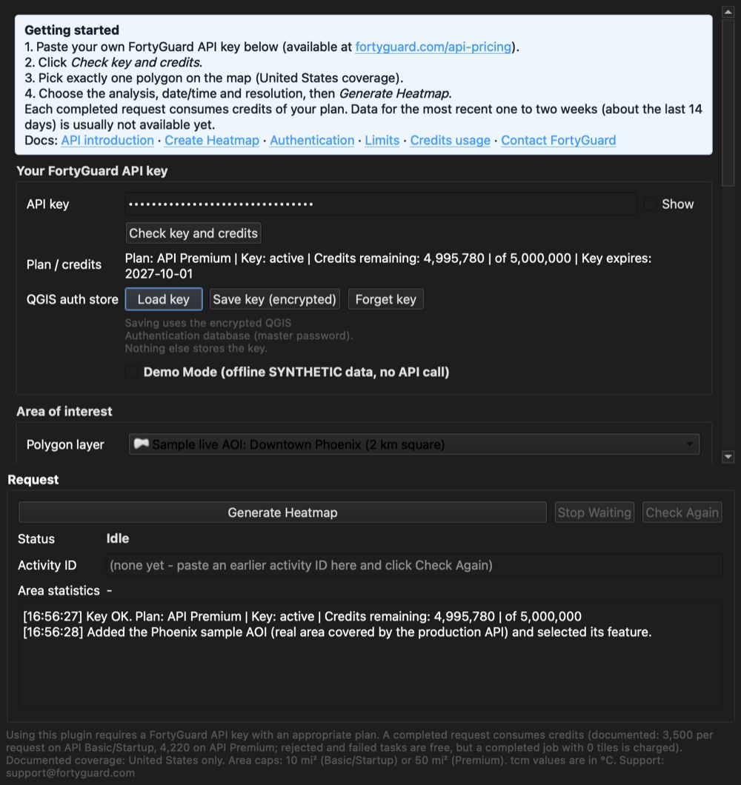
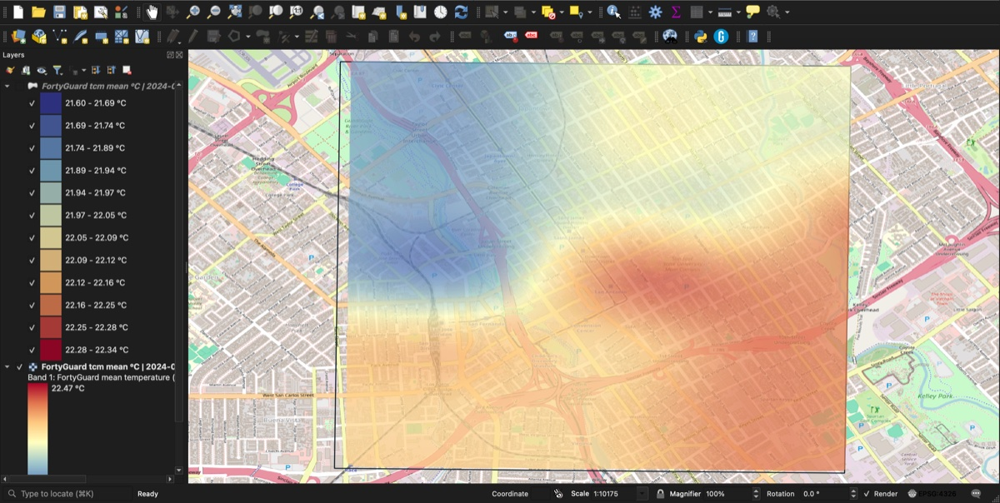
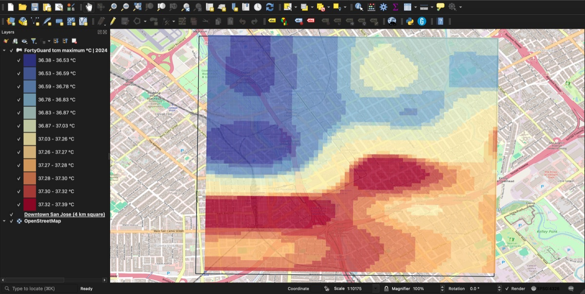
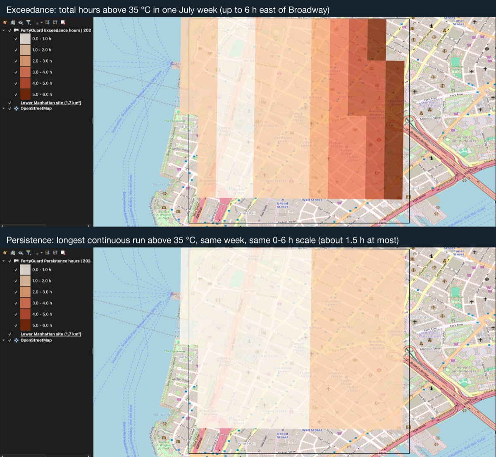

# QGIS integration

*Draft page for docs-api.fortyguard.com (Integrations > QGIS). Images are in `images/` next to this file and
are also served from
`https://raw.githubusercontent.com/FortyGuard-Tech/qgis-fortyguard-heatmap/main/docs/integrations/qgis/images/<file>`.*

---

The **FortyGuard Temperature Intelligence Layer** plugin brings the FortyGuard Temperature API into QGIS.
Select a polygon on your map, choose an analysis and a time window, and the plugin adds the result as a styled
layer: hyper-local temperature (°C), hours above a threshold (exceedance), the longest hot spell (persistence) or
the hour of peak temperature, at 60 to 100 m resolution.



The plugin is a thin client for the API. It sends one `POST /v1/heatmap` request per run with your own API key,
polls the job status, then saves and styles the returned tiles. Nothing is stored on FortyGuard's side beyond the
request itself, and the plugin never sends data anywhere except `api.fortyguard.com`.

## Requirements

| Item | Detail |
|------|--------|
| QGIS | 3.34 or newer (tested on 3.40 to 3.44, macOS, Windows and Ubuntu). QGIS 4 (Qt 6) is not supported yet. |
| API key | Any FortyGuard API plan. Get one at [fortyguard.com/api-pricing](https://www.fortyguard.com/api-pricing); both self-service plans start with a free trial. |
| Coverage | United States. Areas outside the US are stopped by the plugin before anything is charged. |
| Dependencies | None beyond QGIS itself. |

## Install

The plugin is distributed from the FortyGuard plugin repository, which QGIS treats like any other plugin
repository: install, update and uninstall happen in the Plugin Manager.

1. In QGIS open **Plugins > Manage and Install Plugins…**
2. Click **Settings** in the left column, then **Add…** under *Plugin Repositories*.
3. Enter **Name** `FortyGuard` and this **URL**, keep *Enabled* ticked and click **OK**:

   ```
   https://fortyguard-tech.github.io/qgis-fortyguard-heatmap/plugins.xml
   ```

   

4. QGIS fetches the repository and lists it as *connected*.

   

5. Go back to **All**, search for *FortyGuard* and click **Install Plugin**.

   

A FortyGuard button appears in the Plugins toolbar and under **Plugins > FortyGuard Temperature Intelligence
Layer**. New versions show up in the Plugin Manager automatically.

**Alternative: install from ZIP.** Download the current package from
[fortyguard-tech.github.io/qgis-fortyguard-heatmap](https://fortyguard-tech.github.io/qgis-fortyguard-heatmap/)
and use **Plugins > Manage and Install Plugins… > Install from ZIP**.

## Connect your API key

1. Click the FortyGuard toolbar button to open the plugin.
2. Paste your API key into **API key** and click **Check key and credits**. The plugin calls the credits
   usage endpoint and shows your plan, key status and remaining credits.
3. Optional: **Save key (encrypted)** stores the key in the QGIS Authentication database (protected by the
   QGIS master password) so you do not have to paste it again. Nothing else stores the key.



## Run an analysis

1. **Area of interest.** Pick a polygon layer and select exactly one feature on the map. The plugin shows the
   area in km² and mi² and warns before you exceed your plan's allowance.
   A verified sample area (downtown Phoenix, 2 km square) is one click away for a first test.
2. **Analysis.** Choose one of:

   | Analysis | What each tile shows | API `analytic_type` |
   |----------|----------------------|---------------------|
   | Temperature / Snapshot | Temperature in °C (mean, minimum or maximum for daily windows) | `tcm` |
   | Exceedance | Total hours above the threshold you set | `exceedance` |
   | Persistence | Longest continuous run of hours above the threshold | `persistence` |
   | Peak temperature time | Hour of day (UTC) when the tile is hottest | `time_of_measure` |

3. **Time window.** Single hour, range of hours (same day), single day, range of days (up to 31 days) or a
   whole calendar month. Start and end times are the local time of the area; peak temperature hours are UTC.
   Dates default to two weeks ago because data for the most recent one to two weeks is usually not
   available yet.
4. **Resolution.** 60, 80 or 100 m tiles.
5. Click **Generate Heatmap**. Before sending, the plugin checks the area, the dates and whether the same
   request was already run. It then submits one request, polls the job without blocking QGIS and reports
   progress in the log.

## What you get

Each run produces:

- A **smooth temperature surface** (interpolated raster, clipped to your polygon) shown on top, and the
  **exact tiles** as a hidden vector layer underneath. Switch between them in the Layers panel. Peak temperature
  time is tiles only, with six clock classes.
- The tiles as a **GeoJSON** file in the output folder you choose, with the raw API values, plus the smooth
  surface as GeoTIFF.
- A legend sized to the result (classes merged automatically for uniform results) and a one-line summary in the
  log: valid tiles, range, and for analyses the share of tiles above zero hours, maximum duration or most common
  peak hour.







## Credits and limits

- Credits are consumed only when a request reaches *Completed*. Rejected and failed requests are free.
- Documented cost per heatmap request: 3,500 credits on API Basic and API Startup, 4,220 on API Premium.
  The plugin shows the expected cost and your remaining credits in the confirmation dialog before it sends.
- Documented maximum area per heatmap: 10 mi² (Basic, Startup) and 50 mi² (Premium).
- Identical re-runs are charged again; the plugin warns when you repeat a request it has already seen.
- See [Credits usage](https://docs-api.fortyguard.com/docs/credits-usage) and
  [Limitations](https://docs-api.fortyguard.com/docs/limitations).

## Demo Mode

Tick **Demo Mode** to replay clearly labelled synthetic data offline, with no key and no credits. Use it to
learn the workflow or to demonstrate the layers before you have a key. Demo layers are named as synthetic and
are never mixed with live results.

## Troubleshooting

| Symptom | What to do |
|---------|------------|
| Plugin not listed after adding the repository | Click **Reload all Repositories** in Settings; make sure the URL ends with `plugins.xml`. |
| "Temperature data is unavailable" for your dates | Move the date back; the newest available day is usually one to two weeks ago. |
| "Outside supported U.S. coverage" | Coverage inside the US depends on the location and date. Try the Phoenix sample area to confirm your setup, then your own area with an earlier date. |
| Key check fails | Confirm the key in your FortyGuard account and that the plan is active. The plugin uses the production API by default. |
| Request keeps waiting | Click **Stop Waiting**; the activity ID stays in the dialog and **Check Again** resumes polling later. |

## Links

- Plugin repository and install page: <https://fortyguard-tech.github.io/qgis-fortyguard-heatmap/>
- Source code and README: <https://github.com/FortyGuard-Tech/qgis-fortyguard-heatmap>
- Issues: <https://github.com/FortyGuard-Tech/qgis-fortyguard-heatmap/issues>
- API reference: [Create Heatmap](https://docs-api.fortyguard.com/docs/create-heatmap),
  [Authentication](https://docs-api.fortyguard.com/docs/authentication)
- Support: <support@fortyguard.com>

License: GPL-2.0-or-later (the plugin), as required for QGIS plugins.
